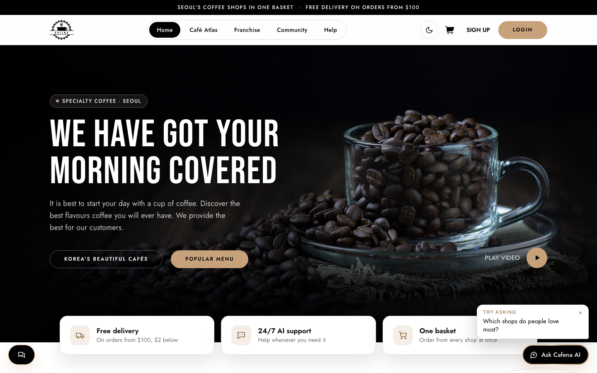
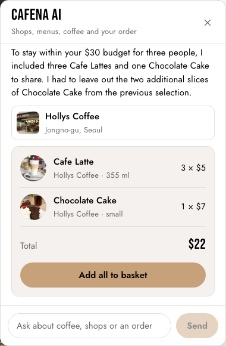
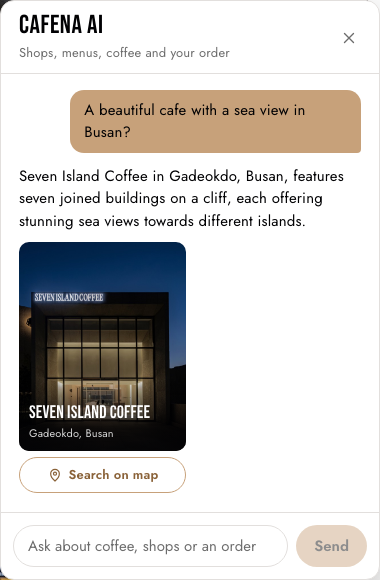

# Cafena

A coffee marketplace for Seoul, live at **[cafena-coffee.com](https://cafena-coffee.com)**. Coffee shops sell beans, machines and accessories; visitors browse, search, review and order from every shop in one basket. Includes a franchise directory, a café atlas, a live weather widget and real-time updates over socket.io.

Full-stack project: I built the backend, both frontends and the AI assistant, and I run the server.

> The source code is private. This repo documents what the service is and how it works.



## AI order assistant

The visitor tells Cafena AI what they want and their budget ("coffee and cake for three people, $30") and it builds a real order from real menus, which lands in the basket with one tap. Two rules keep it honest:

- The model only returns menu line numbers. Prices, totals and the budget limit are computed and enforced in code, never by the model.
- Shops, menu items and café atlas places come only from Cafena's own data, in the visitor's language. The assistant cannot invent a shop or a price.

<p>
  
  
</p>

## Shop panel and admin

Coffee shops sign up and manage their own menu with photos in a server-rendered panel (EJS, session auth). An admin table lists every shop; status and "top shop" switches update in place, and paused or deleted shops disappear from the storefront.

## Architecture

```
React + Redux + MUI storefront ──┐
                                 ├── Express MVC backend ── MongoDB (9 Mongoose schemas)
EJS shop panel + admin ──────────┘      │
                                        ├── socket.io (live updates)
                                        └── Gemini API (order assistant)
```

- **Backend:** Node.js, Express, TypeScript, MVC structure, JWT in cookies for the API and sessions for the panel, bcrypt, Multer uploads.
- **Data:** 9 Mongoose schemas: members (users and coffee shops), products, orders, order items, articles, comments, likes, follows, views.
- **Deployment:** Linux VPS with Docker, Nginx, firewall, DNS and PM2.

## Stack

`Node.js` `Express` `TypeScript` `MongoDB` `Mongoose` `React` `Redux` `MUI` `socket.io` `EJS` `JWT` `Gemini API` `Docker` `Nginx` `PM2`

## Author

**Azamat Solijonov (Allan)** · Seoul · [GitHub profile](https://github.com/Azamat9507) · solijonov.azamat9507@gmail.com
